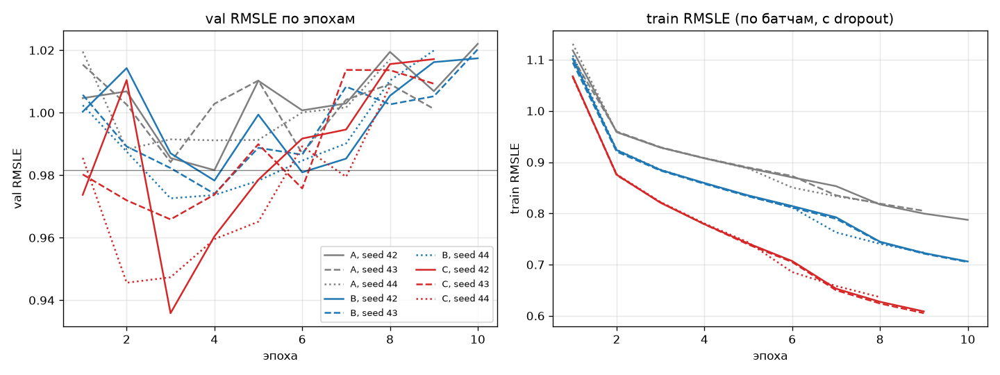

# Эксперимент: представление текста WORK_DESC (val)

Все сравнения — на val (n = 106 421); test не используется. Baseline не меняется.
Гиперпараметры модели и обучения — как у baseline. Парный bootstrap B = 2000 против A с тем же seed.

## Варианты

- **A** — SVD(64) → 1 токен (baseline)
- **B** — SVD(256) → 8 токенов × 32
- **C** — SVD(64) + слова-токены (L = 72)

SVD(256): объяснённая дисперсия 0.579 (SVD(64) — 0,437).

Словарь C: 14692 кодов (с PAD и UNK), df ≥ 5; длина на train — медиана 21, 95-й перцентиль 67; L = 72: обрезано 19090 текстов train (3.84%) и 25198 val (23.68%); доля UNK среди слов val 0.67%.

## Все запуски

| variant | seed | n_val | val_rmsle | val_mdape_pct | val_within25 | best_epoch | epochs_run | sec_per_epoch | train_seconds | n_params | n_tokens |
|---|---|---|---|---|---|---|---|---|---|---|---|
| A | 42 | 106421 | 0.9816 | 44.4556 | 0.3063 | 4 | 10 | 21.0796 | 211.8000 | 1481857 | 30 |
| A | 43 | 106421 | 0.9842 | 46.8894 | 0.2875 | 3 | 9 | 21.0453 | 189.5000 | 1481857 | 30 |
| A | 44 | 106421 | 0.9883 | 46.4069 | 0.2932 | 2 | 8 | 21.0799 | 168.8000 | 1481857 | 30 |
| B | 42 | 106421 | 0.9783 | 41.9271 | 0.3287 | 4 | 10 | 26.7935 | 268.2000 | 1520065 | 37 |
| B | 43 | 106421 | 0.9741 | 44.4290 | 0.3157 | 4 | 10 | 26.7722 | 267.9000 | 1520065 | 37 |
| B | 44 | 106421 | 0.9726 | 46.4259 | 0.3007 | 3 | 9 | 26.7500 | 241.0000 | 1520065 | 37 |
| C | 42 | 106421 | 0.9359 | 46.4664 | 0.2990 | 3 | 9 | 132.3649 | 1191.5000 | 4316545 | 102 |
| C | 43 | 106421 | 0.9659 | 48.1279 | 0.2978 | 3 | 9 | 123.9308 | 1115.6000 | 4316545 | 102 |
| C | 44 | 106421 | 0.9456 | 44.3213 | 0.3105 | 2 | 8 | 123.3724 | 987.2000 | 4316545 | 102 |

## Парные сравнения с A (тот же seed), percentile bootstrap

| variant | seed | d_rmsle | d_rmsle_low | d_rmsle_high | d_mdape_pp | d_mdape_pp_low | d_mdape_pp_high | d_within25 | d_within25_low | d_within25_high | ci_excludes_0 |
|---|---|---|---|---|---|---|---|---|---|---|---|
| B | 42 | -0.0033 | -0.0067 | -0.0000 | -2.5286 | -2.8039 | -2.2572 | 0.0223 | 0.0197 | 0.0248 | True |
| B | 43 | -0.0101 | -0.0137 | -0.0062 | -2.4604 | -2.7597 | -2.1480 | 0.0282 | 0.0255 | 0.0308 | True |
| B | 44 | -0.0157 | -0.0194 | -0.0121 | 0.0190 | -0.2837 | 0.3341 | 0.0075 | 0.0049 | 0.0102 | True |
| C | 42 | -0.0458 | -0.0502 | -0.0412 | 2.0108 | 1.6847 | 2.3159 | -0.0074 | -0.0103 | -0.0043 | True |
| C | 43 | -0.0183 | -0.0225 | -0.0140 | 1.2384 | 0.8571 | 1.5747 | 0.0103 | 0.0076 | 0.0133 | True |
| C | 44 | -0.0427 | -0.0467 | -0.0387 | -2.0855 | -2.3892 | -1.7639 | 0.0173 | 0.0145 | 0.0201 | True |

## По вариантам (среднее и min–max по seed)

| variant | n_seeds | rmsle_mean | rmsle_min | rmsle_max | mdape_mean | within25_mean | best_epoch_mean | sec_per_epoch | n_params | n_tokens | d_rmsle_mean | d_rmsle_min | d_rmsle_max | d_mdape_mean | d_within25_mean | ci_excl0_all | d_rmsle_high_max | passes_rule |
|---|---|---|---|---|---|---|---|---|---|---|---|---|---|---|---|---|---|---|
| A | 3 | 0.9847 | 0.9816 | 0.9883 | 45.9173 | 0.2957 | 3.0000 | 21.0683 | 1481857 | 30 | nan | nan | nan | nan | nan | nan | nan | False |
| B | 3 | 0.9750 | 0.9726 | 0.9783 | 44.2607 | 0.3150 | 3.6667 | 26.7719 | 1520065 | 37 | -0.0097 | -0.0157 | -0.0033 | -1.6566 | 0.0193 | True | -0.0000 | False |
| C | 3 | 0.9491 | 0.9359 | 0.9659 | 46.3052 | 0.3024 | 2.6667 | 126.5560 | 4316545 | 102 | -0.0356 | -0.0458 | -0.0183 | 0.3879 | 0.0067 | True | -0.0140 | True |

## Разбивка RMSLE по типу разрешения: A и C, seed 42

| group_col | group | n | rmsle_A | rmsle_C | d_rmsle_C_vs_A | d_rmsle_C_vs_A_low | d_rmsle_C_vs_A_high | d_rmsle_C_vs_A_method |
|---|---|---|---|---|---|---|---|---|
| PERMIT_TYPE | Bldg-Addition | 11584 | 0.7804 | 0.7695 | -0.0109 | -0.0207 | -0.0015 | BCa |
| PERMIT_TYPE | Bldg-Alter/Repair | 86467 | 1.0321 | 0.9782 | -0.0539 | -0.0590 | -0.0486 | percentile |
| PERMIT_TYPE | Bldg-New | 8370 | 0.6357 | 0.6561 | 0.0204 | 0.0086 | 0.0342 | BCa |
| PERMIT_SUB_TYPE | 1 or 2 Family Dwelling | 78937 | 0.8253 | 0.7938 | -0.0315 | -0.0355 | -0.0273 | percentile |
| PERMIT_SUB_TYPE | Apartment | 15452 | 1.1869 | 1.0713 | -0.1155 | -0.1301 | -0.1010 | BCa |
| PERMIT_SUB_TYPE | Commercial | 12032 | 1.4984 | 1.4623 | -0.0361 | -0.0530 | -0.0193 | BCa |

## Вывод

Правило решения: средний ΔRMSLE по seed ≤ -0.02 и CI парного bootstrap не содержит 0 при каждом seed.

- B: средний ΔRMSLE -0.0097 (min–max -0.0157…-0.0033); CI без 0 при всех seed: да — не проходит.
- C: средний ΔRMSLE -0.0356 (min–max -0.0458…-0.0183); CI без 0 при всех seed: да — **проходит**.

## Разбор

**C (слова как токены) формально проходит правило решения.** Средний ΔRMSLE −0,036 (по seed −0,046 / −0,018 / −0,043), CI парного bootstrap не содержит 0 ни при одном seed. Выигрыш сосредоточен там, где SVD(64) теряет детали текста: Alter/Repair −0,054 [−0,059; −0,049], Apartment −0,116, 1 or 2 Family −0,031, Commercial −0,036. На Bldg-New C хуже: +0,020 [+0,009; +0,034]. У новых зданий стоимость определяют площадь и тип, а текст шаблонный.

**B (SVD(256), 8 токенов)** даёт стабильный, но малый выигрыш −0,010 (по seed от −0,003 до −0,016). Это в пределах разброса между seed, правило не проходит. Зато B улучшает MdAPE (−1,7 п.п.) и долю в ±25% (+1,9 п.п.), у C эти метрики почти не меняются: в среднем +0,4 п.п. MdAPE и +0,7 п.п. по доле в ±25%, знак зависит от seed. C в основном сокращает крупные ошибки, а не уточняет типичный прогноз.

**Оговорки:**
1. **Выбор эпохи по val.** Ранняя остановка и сравнение идут на одном и том же val, а кривые val шумные. У C seed 42 значения по эпохам 1,010 → 0,936 → 0,960, при этом эпоха 3 — лучшая. Минимум шумной кривой смещён вниз, и у более шумного варианта это смещение больше. Поэтому часть выигрыша C может быть артефактом выбора эпохи. Разброс C между seed (0,936–0,966) втрое больше, чем у A (0,982–0,988). Честная проверка без test: ранняя остановка по одной половине val (например, по датам), оценка на другой.
2. **Сдвиг длины текста.** L = 72 выбран по train (95-й перцентиль 67), но на val тексты длиннее: медиана 26 против 21, обрезано 23,7% текстов против 3,8% на train. Это те же шаблоны (Eplan и др.), что и в сдвиге из ПР1. Если увеличить L до 96–128, результат C может измениться в любую сторону.
3. **Цена.** C в 6 раз медленнее (≈ 125 с/эпоху против 21 с) и имеет в 2,9 раза больше параметров (4,3 млн, из них 2,8 млн — эмбеддинги слов). Train RMSLE падает до 0,61 к 8-й эпохе: модель быстро переобучается, лучшая эпоха 2–3.
